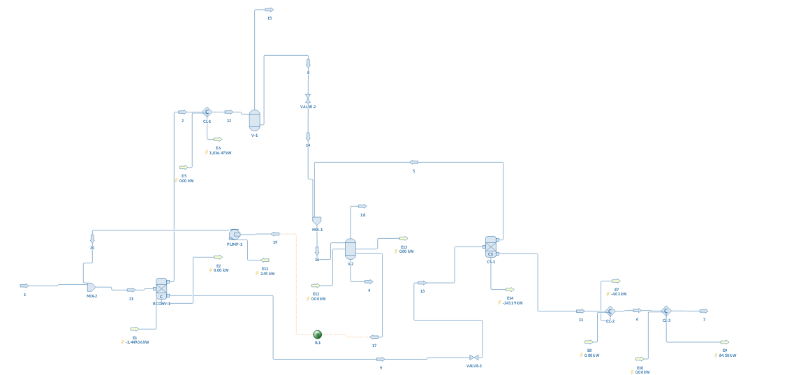

# Benzoic Acid Plant – DWSIM Simulation

DWSIM simulation of a 12,000 t/yr toluene-oxidation benzoic acid plant, built to cross-check my design group's hand mass and energy balances (Chemical Engineering, University of Manchester).

## What it does
- Full flowsheet with converged toluene recycle (0.17% average recycle error)
- Conversion reactor (165 °C, 8 bar, 15% per-pass conversion), cooler-condenser, flash drum, decanter, distillation column and product coolers
- Raoult's law throughout, matching the hand-calculation basis, with immiscible water enabled at the decanter

## Key findings
- Material balance agrees with hand values within 1–5% around the reactor, flash drum and vent; overall closure 0.69%, explained by the recycle tolerance
- Converged recycle gives 15.59 kmol/h benzoic acid (15,234 t/yr), so 12,000 t/yr needs a 0.788 feed scale factor
- Identified an unclosed water balance: about 6 kmol/h of reaction water would build up in the recycle loop unless all of it leaves at the decanter
- Reactor cooling duty of about 1.45 MW against 3.6 MW by hand, traced to a double-counted inlet enthalpy
- Column condenser and reboiler duties showed the hand values assumed zero reflux
- Reactor off-gas O₂/N₂ ratio of 0.029, inside the 0.0625 flammability limit

## Limitations
- Ideal VLE treats toluene and water as miscible outside the decanter; NRTL would improve the vent and flash-drum results
- Column modelled as a component split (99% benzoic acid recovery) after rigorous column models failed to converge
- Fixed 15% conversion rather than a kinetic reactor model

Full write-up: [Benzoic_Acid_DWSIM_Simulation_Report.pdf](Benzoic_Acid_DWSIM_Simulation_Report.pdf)

## Files
- `Final benzoic acid plant.dwxmz` – DWSIM simulation (open in DWSIM)
- `Benzoic_Acid_DWSIM_Simulation_Report.pdf` – full report with stream tables and comparison
- `Flowsheet.png` – flowsheet screenshot
